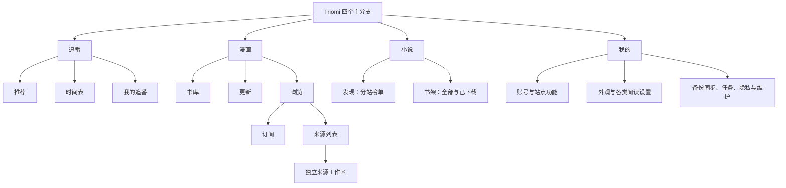

# 四模块重构大纲：追番 / 漫画 / 小说 / 我的

日期：2026-10-16。编号：R152（设计）/ R153（实施）。状态：**用户已批准，正在实施；完成状态与发布证据以 CURRENT_STATUS 为准**。

本文是用户本轮明确要求的完整重构提案；执行进度仍只由 [ROADMAP](ROADMAP.md) 和 [CURRENT_STATUS](CURRENT_STATUS.md) 维护。C151 发布版不因本文自动升级；不得把本文的目标、交互或性能门槛写成已验收结果。

## 1. 结论与范围

采用**按使用场景垂直拆分的四个 Module**，而不是把同一套发现、搜索、书架控件再套三层类型筛选：

- **追番**：Kazumi 式推荐、时间表、我的追番，独立资料与播放来源链路。
- **漫画**：Android Komikku 式书库、更新、浏览；订阅、独立来源工作区、扩展和仓库各司其职。
- **小说**：MixN 式分站发现、双源小说搜索、全部/已下载书架，以及现有完整阅读与站点能力。
- **我的**：保留统一设置、账号、备份、下载任务与维护能力；不作为日常内容入口的必经中转站。

用户已批准本大纲并授权并行实施、完成后提交推送GitHub和发布Release。实施覆盖下文全部日常工作流，不以脚手架或计划交付代替可用功能。

### 1.1 用户要求逐项落点

| 要求 | 决策 | 详细位置 |
| --- | --- | --- |
| 点击番剧加载很慢甚至失败 | 先修网络路径与加载依赖，缓存先展示，播放不依赖资料成功 | §3、§5、§11 R0 |
| 筛选挤在一起、没有分界 | 统一分组面板、标题/分隔线/间距、固定操作区 | §8 |
| 不需要类型过滤 | 不显示番剧/漫画/小说类型筛选；番剧筛选也移除 TV/剧场版/OVA 等格式下拉 | §5.2、§8 |
| 标签应选择而不是输入 | 标签选项、多选与已选区，不再用自由文本填写题材 | §8.2 |
| 漫画订阅不要手填名称 | 选择来源即订阅，自动“来源 · 最近更新”；没有更新能力时如实标为热门 | §6.2 |
| 点击 Feed 能进入插件独立工作区 | 订阅标题进入原来源目录，保留入口的榜单/查询/筛选，并支持独立搜索与翻页 | §6.3 |
| 搜索按三类分开 | 三个独立入口与状态；漫画全源搜索按来源渐进返回，呈现对齐 Android Komikku | §5.3、§6.4、§7.3 |
| 书架移除“番剧（旧）” | 删除该 UI 和相关兼容分支，原数据只在追番内可见，绝不删收藏/历史 | §9 |
| 漫画、小说书架贴近各自原软件 | 漫画保留分类和更新管理；小说保留全部/已下载与分站未读 | §6.5、§7.2 |
| 顶部工具太多 | 默认只保留搜索与更多；筛选按场景出现，批量操作只在选择模式出现 | §8.1 |
| 底部四大模块、互不干涉 | 四个 StatefulShell 分支；模块级搜索、筛选、分页、收藏视图与生命周期隔离 | §4、§10 |
| 深调研三款软件后给出完整大纲 | 固定源码版本、参考截图、差异矩阵、迁移与交付门槛 | §2、§9–§13 |

## 2. 调研依据：不是同名软件混用，也不是照旧文档猜实现

### 2.1 固定版本与证据层级

| 对象 | 本轮只读源码快照 | 定位与限制 |
| --- | --- | --- |
| Triomi | `37b12bde82d1bf2aa9acce5022736fc6a6a4ef7e` | C151 后主干；现有功能以当前源码和 CURRENT_STATUS 为准 |
| Kazumi | `02afdabf72af7eee04a7403786ee60236701086c` | Flutter 番剧应用，GPL-3.0；参考交互和公开协议 |
| Komikku | `64aeb48f31a211e734dafe6c838ae2c712ae69e2` | **komikku-app/komikku，Android、Mihon/TachiyomiSY 衍生应用，Apache-2.0**；不是 GNOME/Python 同名软件 |
| MixN | `ac05d544dc00dc0f3c917e326b2198e2a7145c61` | 用户自有 Kotlin 小说应用；源码默认版本 1.21.2，可被构建环境覆盖，不能仍按旧规格的 1.17.0 声称当前功能 |

本轮深读导航、发现、Feed、搜索调度、原始来源筛选、收藏/书架、详情加载及小说来源契约。已打开三款上游仓库的界面图，以及 Triomi C151 界面证据。上游截图是仓库保存的历史画面，不等于固定源码版本的实时 UI。

本轮 `adb devices -l` 没有在线设备，**没有重新实操三个参考 App 或做 Android 新版界面验收**。C124 的参考 App 操作记录见 [历史调研](delivery/C124_KAZUMI_KOMIKKU_RESEARCH.md)，只作为历史旁证，不能替代新包验证。未修改 `_refs`、未读取旧账号文件、未登录、未执行远端写入。

### 2.2 Kazumi：应保留什么，不能盲抄什么

| 场景 | 源码确认 | Triomi 的重构决定 |
| --- | --- | --- |
| 推荐与内容资料 | 推荐作品携资料身份；详情先用传入作品，按需补资料 | 推荐卡片快照立即可见，不为了补简介阻塞观看入口 |
| 详情资料分区 | 评论、角色、关联、Staff 按 Tab 首次访问加载 | 分区独立成功/缓存/错误；不在首屏一次等待所有分区 |
| 播放来源 | 各插件分组返回；单站别名、重试、可见验证；关闭取消搜索 | 播放候选仍按站点分组；复用已确认关联，不重新确认同一对身份 |
| 站内目录 | 选候选后取真实播放列表，再进入播放器 | 用户一次选择作品后在同一详情切到播放区，不再推一层同类详情 |
| 追番 | 五态、名称/别名搜索、排序与卡片/列表 | 保留在看/想看/看过/搁置/抛弃，状态与排序分开 |
| 时间表 | 当季、历史季、星期；仅在看、隐藏看过/抛弃、排序 | 时间表从混合页独立为追番的二级页，筛选不改推荐或追番列表 |
| 筛选 | 分组、分隔线、题材 chips、日期与评分等 | 采用层次，不照搬上游额外的自定义标签输入；本次用户要求选择标签 |
| 网络与镜像 | 直连/ECH/镜像有各自传输路径；部分镜像请求使用上游签名 | 只接公开无凭据契约；不复制签名密钥，不把一个推荐镜像当全部接口镜像 |

依据：[详情延迟加载](https://github.com/Predidit/Kazumi/blob/02afdabf72af7eee04a7403786ee60236701086c/lib/pages/info/info_page.dart#L204-L305)、[来源选择](https://github.com/Predidit/Kazumi/blob/02afdabf72af7eee04a7403786ee60236701086c/lib/pages/info/source_sheet.dart#L54-L147)、[筛选分组](https://github.com/Predidit/Kazumi/blob/02afdabf72af7eee04a7403786ee60236701086c/lib/pages/search/search_filter_sheet.dart#L184-L280)、[追番查询](https://github.com/Predidit/Kazumi/blob/02afdabf72af7eee04a7403786ee60236701086c/lib/pages/collect/collect_library_query.dart)、[时间表](https://github.com/Predidit/Kazumi/blob/02afdabf72af7eee04a7403786ee60236701086c/lib/pages/timeline/timeline_controller.dart)、[镜像鉴权条件](https://github.com/Predidit/Kazumi/blob/02afdabf72af7eee04a7403786ee60236701086c/lib/request/clients/bangumi_client.dart#L73-L121)。

### 2.3 Android Komikku：订阅、来源、扩展不是同一个东西

| 场景 | 源码确认 | Triomi 的重构决定 |
| --- | --- | --- |
| 浏览组织 | Sources / Feed / Extensions / Migrate 分离，可配置 Feed 次序 | 漫画“浏览”保留订阅/来源切换，扩展仓库独立页，迁移放管理菜单 |
| 订阅添加 | 选择来源，再选择默认内容或已保存搜索；创建 Feed 没有手填名称参数 | 普通订阅只选来源并确认；保存搜索也默认自动命名，可选改名而非必填 |
| 默认 Feed | 支持 latest 用最近更新，否则真实调用 popular | 不支持 latest 的来源显示“热门 · 本来源未提供最近更新”，不能贴假“更新”标签 |
| Feed 呈现 | 来源标题、语言说明、横向作品行、每行独立状态与结果 | 订阅不再是一张嵌着分页和编辑表单的大卡片；点击行标题看完整目录 |
| 独立来源页 | Browse、Latest、Saved Search、来源内搜索/筛选、网站与设置 | 新增真正单源工作区，不是打开现有 Feed 卡片的放大 BottomSheet |
| 跨源搜索 | 一个来源一行，Loading/Success/Error；完成一个更新一个 | 不再等所有 Future 完成才显示；标题进入该源完整搜索结果 |
| 原始筛选 | Header/Separator/Group/CheckBox/TriState/Select/Sort/Text/AutoComplete | 保留插件原始语义，不把所有来源硬套一套虚构题材 |
| 书库 | Filter / Sort / Display / Group 分区，未读/下载/开始/完结/追踪筛选 | 主页面不常驻一长排下拉；分类与局部状态独立于小说 |
| 高级能力 | 更新、下载、迁移、合并、每作品读器设置、追踪、备份已有独立流程 | 重排入口并保留现有实现，不用“UI 简化”删除能力或重新造宿主 |

依据：[浏览分区](https://github.com/komikku-app/komikku/blob/64aeb48f31a211e734dafe6c838ae2c712ae69e2/app/src/main/java/eu/kanade/tachiyomi/ui/browse/BrowseTab.kt#L88-L126)、[Feed 创建和命名](https://github.com/komikku-app/komikku/blob/64aeb48f31a211e734dafe6c838ae2c712ae69e2/app/src/main/java/eu/kanade/tachiyomi/ui/browse/feed/FeedScreenModel.kt#L125-L260)、[latest/popular 与独立返回](https://github.com/komikku-app/komikku/blob/64aeb48f31a211e734dafe6c838ae2c712ae69e2/app/src/main/java/eu/kanade/tachiyomi/ui/browse/feed/FeedScreenModel.kt#L271-L324)、[单源工作区](https://github.com/komikku-app/komikku/blob/64aeb48f31a211e734dafe6c838ae2c712ae69e2/app/src/main/java/eu/kanade/tachiyomi/ui/browse/source/feed/SourceFeedScreen.kt#L111-L175)、[搜索结果行](https://github.com/komikku-app/komikku/blob/64aeb48f31a211e734dafe6c838ae2c712ae69e2/app/src/main/java/eu/kanade/presentation/browse/GlobalSearchScreen.kt#L109-L177)、[搜索取消与渐进更新](https://github.com/komikku-app/komikku/blob/64aeb48f31a211e734dafe6c838ae2c712ae69e2/app/src/main/java/eu/kanade/tachiyomi/ui/browse/source/globalsearch/SearchScreenModel.kt#L145-L219)、[来源筛选](https://github.com/komikku-app/komikku/blob/64aeb48f31a211e734dafe6c838ae2c712ae69e2/app/src/main/java/eu/kanade/tachiyomi/ui/browse/source/browse/SourceFilterDialog.kt)、[书库面板](https://github.com/komikku-app/komikku/blob/64aeb48f31a211e734dafe6c838ae2c712ae69e2/app/src/main/java/eu/kanade/presentation/library/LibrarySettingsDialog.kt)。

不照搬上游将部分 Feed 异常折为空列表的做法。Triomi 必须区分“没有结果”“插件不支持”“请求失败”，避免站点出错被误认为没有更新。

### 2.4 MixN：小说保留双源语义，不塞入漫画书库模板

| 场景 | 源码确认 | Triomi 的重构决定 |
| --- | --- | --- |
| 发现 | 先选 LK/LNS，再选本站频道，不把站点榜单混排 | 小说发现保留站点选择，默认该站热门，各站各自保存频道和位置 |
| LK 频道 | 热门、日榜、周榜、新书、原创、同人、EPUB、最近更新 | 复用现有 LK feeds，按原契约分页，固定榜单到底明确结束 |
| LNS 频道 | 热门、最近更新、新书、日榜、周榜、月榜 | 按登录和来源能力显示；不能套用 LK 的原创/同人或伪造匿名可读 |
| 搜索 | 来源独立 Loading/Success/Failure，双源并行，单站分页与超时 | 小说搜索只查小说来源；保留书名/作者意图和来源错误，不查动画/漫画 |
| 书架 | 全部 / 已下载，来源角标、更新汇总、本地确认未读 | 本地收藏先显示，刷新站点快照不清已有本地书籍；下载页离线可用 |
| 身份和缓存 | sourceId + remoteId；两站认证、正文、字体互不混用 | 沿用现有 SQLite/SecureStore 和小说适配器，不复制另一套账号系统 |
| 阅读及账号 | 分卷目录、分页/滚动、文字锚点、字体、插图、消息/评论/签到 | 全部保留；相关内容入口在小说内，账号维护仍在“我的” |
| 下载与权限 | 上游有导出能力，但具体站点权限仍是事实约束 | LK 合法内容保留 TXT/EPUB；LNS 沿当前官方权限限制，不能因“照搬 MixN”恢复违规整书重打包 |

依据：[领域不变量](https://github.com/HyperionHXH/lightnovel-android-aggregator/blob/ac05d544dc00dc0f3c917e326b2198e2a7145c61/CONTEXT.md)、[发现交互](https://github.com/HyperionHXH/lightnovel-android-aggregator/blob/ac05d544dc00dc0f3c917e326b2198e2a7145c61/app/src/main/java/io/github/jiangyuyi/lightnovel/feature/discover/AggregateDiscoverScreen.kt)、[书架](https://github.com/HyperionHXH/lightnovel-android-aggregator/blob/ac05d544dc00dc0f3c917e326b2198e2a7145c61/app/src/main/java/io/github/jiangyuyi/lightnovel/feature/bookshelf/AggregateBookshelfScreen.kt#L162-L280)、[流式搜索契约](https://github.com/HyperionHXH/lightnovel-android-aggregator/blob/ac05d544dc00dc0f3c917e326b2198e2a7145c61/app/src/main/java/io/github/jiangyuyi/lightnovel/core/source/AggregateSearchCoordinator.kt)、[频道定义](https://github.com/HyperionHXH/lightnovel-android-aggregator/blob/ac05d544dc00dc0f3c917e326b2198e2a7145c61/app/src/main/java/io/github/jiangyuyi/lightnovel/core/source/SourceModels.kt#L77-L88)。

## 3. 番剧慢在哪里：已实跑的诊断，不先承诺万能加速

原始测量、源码版本、失败与未验证范围见 [R152 性能诊断证据](delivery/evidence/R152-anime-loading-research.json)。本轮不是播放器首帧测试。

### 3.1 已测事实

使用当前生产 `DeclarativeSource + DioSourceHttpClient + 随包 bangumi-anime.json`，请求公开条目 `400602`，无账号。对比实验只在临时进程中更改规则 baseUrl；没有改用户来源或随包规则文件。

| 实验 | 第一次 | 第二次 | 观察 |
| --- | --- | --- | --- |
| 原生产域名详情 `api.bgm.tv/v0/subjects/400602` | 20,060 ms 失败 | 20,006 ms 失败 | connection timeout；尚未进入 episodes 请求 |
| 同生产解析器，仅内存 baseUrl 改为公开 `api.bgmapi.com` | 991 ms | 644 ms | 两次均返回正确标题和 36 集目录；detail 与 episodes 均 HTTP 200 |
| curl 公开推荐镜像 | 757 ms | 746 ms | `api.kazumi.fyi/kazumi/v1/popular/subjects` HTTP 200 |
| curl 公开 Next 格式详情镜像 | 383 ms | 未重复 | `api.kazumi.fyi/p1/subjects/400602` HTTP 200，格式不能与 v0 混用 |

另外，`api.kazumi.fyi/v0/subjects/400602` 本轮为 **404**，而同域的 v0 episodes 为 200。说明“换一个镜像域名覆盖所有接口”并不正确。历史 C124 的 bgmapi 403 已不是本轮结果；也不能由本轮成功推导它长期稳定。

curl 失败请求的 DNS 测量约 6–14 ms，TCP connect 未完成；**不支持将本机这次 20 秒等待归因于 DNS 很慢**。不能为此绕过证书、硬编码 IP 或把 LK 专用 DNS 逻辑推广到全部番剧域名。

### 3.2 当前代码中的等待放大点

1. [DetailPage._load](../lib/features/detail/detail_page.dart)：先等整个 `sourcesProvider.future`，再 `detail`，再 `chapters`，最后才返回完整 `_DetailData`。网络详情和目录串行；缓存写入也在该 Future 返回之前。
2. 本地作品与目录缓存是**失败后回退**，不是打开时先读；缓存回退还要求目录非空。只有公开资料缓存、没有目录的条目可能无法得到有效首屏回退。
3. 番剧等待态**已有标题/封面快照和“选择播放来源”按钮**，所以不能说现有代码完全阻止观看；缺陷是加载状态不完整、缓存利用晚、资料链仍有长等待。
4. 推荐已有 next→公开推荐镜像切换，详情 v0 规则和资料分区仍各自直接请求官方域名。列表和详情的可达性不一致，本机实验已经观察到。
5. [SearchPage._search](../lib/features/search/search_page.dart) 使用 `Future.wait`，UI 等整体返回；即便内部捕获单站错误，快来源仍会被最慢来源拖住展示。
6. [SourceRegistry.load](../lib/core/source/source_registry.dart) 依次 await 已启用 JS 初始化，漫画 JS 也在共享注册表里；这是源码确认的跨模块耦合风险，**本轮未测得它占多少耗时，不能写成这次故障的确定根因**。
7. 来源搜索有 30 秒包装 deadline，网页解析 Android 35 秒、Windows 45 秒。它们属于不同阶段，**不能直接相加说每次都会等这些时间**。单纯 `Future.timeout` 不等于底层 HTTP 已取消。

### 3.3 改进决策与不变量

- **首屏与网络解耦**：列表快照 + 本机资料/目录立即显示，后台刷新；资料为空仍展示快照和播放入口，不要求非空章节才能命中缓存。
- **两条加载链**：资料刷新与播放来源/目录独立；角色/评论/Staff 只在访问分区时取。Bangumi 分集资料不是站点可播放目录，不能拿它直接播放。
- **公开资料后端按能力路由**：复用现有网络层，按 info/episodes/search/comments 等实际契约选择可用后端；保存用户显式网络策略。`v0` 和 `p1` 有独立解析 Adapter。推荐镜像不等于详情镜像。
- 默认遵从当前代理/直连设置，不绕过显式代理；只有公开资料读取可使用明确显示的兼容镜像。账号写入和带凭据请求不跟随公开读镜像转发，第三方镜像需有可见说明。
- 当前实测支持优先实现“v0 详情/episodes 的公开兼容后端 + 缓存首屏”；不能据此宣称搜索、评论、全部资料均已支持。无合法后端时明确分区失败，其他功能继续。
- 同作品、同后端、同分区、同页的在途读取合并；持久缓存带来源格式版本与更新时间。缓存成功后刷新失败不清空，评论等分区保持自己的游标。
- 关闭、换作品、改筛选要撤销操作并丢弃晚到结果；传播到 Dio/JS worker/原生宿主各自可取消的实际执行点。不能只隐藏 spinner。
- 已确认来源与最近目录可直接继续；切站、换季仍核对，绝不按同名自动绑定，也不移植另一站秒数。
- 阶段提示明确为“补全资料 / 搜索来源 / 获取目录 / 解析播放页 / 缓冲视频”；单阶段重试不重跑全部链路。

**仍待实施时实测**：用户手机具体线路、真实站点目录耗时、网页嗅探到首帧、缓存命中 UI、注册表初始化成本、网络恢复与请求取消。这些不由两次主机请求代替。

## 4. 四大工作区与导航层次

- 手机底部仅「追番 / 漫画 / 小说 / 我的」；宽屏仍用同四个目的地的 Rail/Sidebar，不嵌套另一排底部栏。
- 首次安装进入追番推荐；之后恢复上次主工作区和该工作区位置。仅切栏不发起其他两类内容请求。
- 追番默认推荐、漫画默认书库、小说默认发现；各自记住上次二级页。二级页是使用任务，不是可清除的类型筛选。
- 每个工作区独立保留页面栈、滚动位置、关键词、筛选草稿/已应用值与游标。重选当前主栏回该工作区入口，不清搜索历史或收藏。
- 顶部搜索始终表示当前内容模块；书库内放大镜先搜索本地收藏，空态给“去全源搜索漫画/小说”，明确区别本地搜索与网络搜索。
- 来源、仓库、设置属于管理页，从当前模块进入自动限于该模块；“我的”仍可进入统一维护入口，但先选管理项目，不在业务页面加跨类型下拉。
- 播放器/读器独占内容区域；返回恢复所属工作区。深链、通知、后台完成跳转携明确模块身份，不依赖某个先前页面的 `extra` 对象存活。

## 5. 追番 Module：围绕“找到—选源—观看—继续”

### 5.1 推荐与详情

- 推荐页以封面网格为主，顶部搜索/更多；筛选入口在内容工具行，当前条件只展示摘要与数量，不常驻整表单。
- 下拉刷新保留旧内容；追加失败保留已加载项并在页尾重试。换排序/筛选从第一页开始，后端/游标不能跨榜单拼接。
- 详情顶部：封面、标题、评分、简介；主操作仅「开始/继续观看」和「加入/管理追番」。分享、下载、资料高级操作进入更多。
- 详情中分「播放 / 资料」；资料内部按需访问简介、角色/声优、Staff、关联、评论、分集信息。信息分区失败不覆盖播放区。
- 已有关联时，主操作使用最后成功站点/列表/集；无关联打开来源选择。新候选首次确认，已确认且未变的映射不每次弹窗。
- 选来源后在**同一作品详情**显示目录，不从 Bangumi 详情再压一个站点详情页。站点身份、列表和章节归属依旧保持，UI 合并不等于数据合并。
- 站点行显示独立加载/错误/重试/人工验证；候选保留季数和原名。暂无可用来源给规则管理入口，不能造可播放按钮。
- 播放器保留选集、同列表上下集、倍速、全屏、字幕、弹幕、下载和进度恢复。高级播放参数进入播放器设置，不放在详情工具栏。

### 5.2 筛选与时间表

- 推荐/番剧搜索筛选：题材标签多选、年份/季度、排序、评分区间、隐藏看过/抛弃。**不显示 TV/剧场版/OVA 等格式筛选，也没有跨内容类型筛选。**
- 标签来自版本化的公开题材选项，展示已选与常用题材，点击选择/取消；选项内搜索只查标签字典，不把文本当自定义标签提交。
- 多标签组合语义以公开后端契约验证为准；实现时固定并标明“同时满足”或后端实际语义，不在客户端静默改成 OR/本地过滤。不能接合法多标签契约时不假装已支持。
- 时间表：当季/历史季度、周一到周日/未注明、今日定位；筛选仅在看、隐藏看过/抛弃、题材与排序。未提供星期的作品留在未注明，不按首播日期猜每周更新。
- 我的追番：全部、在看、想看、看过、搁置、抛弃；本地标题/别名搜索，最近观看/最近变更/标题/评分排序，卡片/列表。批量改状态仅在长按选择后出现。
- “没有播放线路”“资料暂不可用”“这个站需要验证”分别呈现，不能统一成“番剧加载失败”。

### 5.3 番剧搜索

默认搜索番剧资料，呈现 Kazumi 式作品网格；点击进入稳定资料身份，再按需搜索播放站。高级“搜索播放站”是番剧内的明确子模式，只查询已启用且支持播放的番剧来源，按站点渐进返回。不得把资料条目和网站候选混成同一列表，更不能查到漫画/小说。

搜索历史仅属番剧；请求与筛选均绑定当前查询代次。新查询取消旧任务，单站错误不影响别站；已选标签继续参与资料搜索，进站内搜索时只有站点实际支持的条件可传递。

## 6. 漫画 Module：按 Android Komikku 的工作方式组织

### 6.1 三个二级页

- **书库**：收藏、分类、继续阅读；默认页。
- **更新**：按作品/时间分组的新章、未读、更新队列与错误；不是普通来源最新作品榜单。
- **浏览**：默认订阅，切换来源列表；搜索按钮进行漫画全源搜索。扩展管理进入独立页；迁移在管理菜单，不增加常驻图标。

区分两个“更新”：来源“最近更新”是站点目录，书库“更新”是我的收藏的新章节。文案、路由和状态不能互换。

### 6.2 订阅（Feed）

普通流程：**添加订阅 → 选择已启用来源 → 确认**。默认选择最近更新；来源无该能力就选热门并标明。没有名称输入框，没有保存前“请填写 Feed 名称”。

- 标题自动由当前来源显示名 + 频道名组成；副标题显示语言和状态。一个 APK 可暴露多个语言/sourceId，订阅对象是具体来源，不是整包。
- 每行展示一组横向封面，标题右箭头进入完整目录；点封面进作品。按来源独立加载，失败行局部重试，不挡别行。
- 默认每来源只建立一个基础订阅，而不是现有 seed 对所有榜单各建一行；热门/其他榜单从单源页访问。用户可显式再订阅不同榜单或保存搜索。
- 新安装来源不自动铺满订阅；由用户勾选。首次迁移保留已有订阅配置与顺序，不静默删除历史 popular/latest 两行。
- 精确重复订阅以 sourceId + 操作/频道 + 查询 + 结构化筛选指纹识别，已有时定位已有行；不按展示标题去重，不合并不同语言来源。
- 长按行：排序/移除；删除仅记录订阅墓碑，不卸载插件、不删收藏、历史或离线文件。显式重新添加同一订阅可撤销墓碑；自动播种不能复活它。
- 保存搜索来自单源已应用的查询和筛选，默认名由关键词/条件生成；可选修改保存搜索名称，不强迫普通订阅命名。

### 6.3 每个来源独立工作区

打开来源列表项或订阅标题均进入同一来源工作区，携 `sourceId + listing + query + filterSnapshot`。页面包含：

1. 来源名称、语言和能力状态；搜索只查当前来源。
2. 热门 / 最近更新（仅支持时）以及已保存搜索 chips；从 Feed 来默认进入原频道，从跨源搜索来默认进入原查询结果。
3. 完整分页网格、列表/网格展示设置；分页使用来源真实 `hasNextPage`，不是一律用“少于 20 条”判定 APK 到底。
4. 筛选面板保留原始分组、单/多选、包含/排除、排序；保存搜索和订阅本筛选是面板中的明确操作。
5. 来源设置、打开网站、会话验证、扩展信息在更多；需要信任、停用或不支持平台时给准确入口。
6. 返回保留订阅列表位置、单源查询与结果。切到另一来源不串筛选、分页或 Cookie。

**禁止继续把 `_openSaved` 的单卡片 BottomSheet 当作单源浏览页。**

### 6.4 漫画全源搜索：界面与返回行为对齐 Komikku

- 标题“搜索漫画”，只搜索已启用且具备搜索能力的漫画来源；提供全部/固定来源范围，不出现番剧/小说选项。
- 一个来源一组：名称、语言、完成/失败状态 + 横向结果行；快来源先展示，顶栏进度只表示完成多少来源，不遮住结果。
- 点击来源标题进入该源完整搜索网格，携当前关键词；来源筛选保存在该单源工作区，不作为全源所有插件通用条件强行传递。
- 搜索任务有并发上限、每站超时和单站重试；取消/改词后旧任务不得更新新结果。默认查询所有符合当前范围的可搜索来源，不只查已订阅 Feed。
- 插件明确不支持搜索时不发请求，给“此来源不支持搜索，可浏览热门”；空结果、失败与不支持不是同一状态。
- 搜索能力未知时按原协议尝试并保留结果；不能把一次空结果、超时或未命中关键词推断成“不支持搜索”。只有插件明确声明/明确能力错误才调整后续入口。
- 不按标题合并不同来源的作品；合并仍需要明确操作与章节身份规则。

### 6.5 漫画书库、更新与读器

- 分类 Tab + 封面网格是主体；书库本地搜索入口与“筛选/排序/显示/分组”面板分离，不常驻所有控件。
- 筛选支持已下载、未读、阅读中/未开始、完结、书签/追踪（对应功能真实存在时）；三态项使用不限/包含/排除。
- 排序保留标题、最近阅读、最近更新、未读数、加入时间；扩展的排序与书库排序完全独立。
- 来源/语言与未读/下载角标可辨识；没有元数据时未知不冒充已知。隐藏分类不是安全锁。
- 长按进入选择模式，临时工具栏提供分类、标记已读、下载、移除、合并/迁移；仅处理当前明确选中集合，筛选变化先退出选择。
- 更新页支持按作品分组、阅读新章、下载、检查状态与错误重试；智能更新约束/通知/自动下载沿已有生产实现。
- 详情与读器保留章节筛选、批量下载、阅读方向、条漫/分页/双页、裁边/滤镜/预载、每作品设置和进度恢复。稀有设置归各自面板，不在书库堆开关。
- 本地漫画库入口放书库更多，仍可从“我的”数据管理访问同一实现；不复制导入器。
- 扩展页继续分已安装/浏览扩展/仓库；签名信任、失败保留旧版本、停用恢复 APK 的安全流程原样保留。来源浏览与扩展安装不是同一张列表。

## 7. 小说 Module：MixN 的发现与书架完整回到小说内部

### 7.1 发现

顶栏“小说”与搜索/更多；发现页先用站点选择器选 LK/LNS，再显示本站频道。热门是默认频道，各站保持独立选择和滚动位置；不把漫画 Feed 搬到小说发现。

- LK 和 LNS 频道来自各自适配器，不能让不支持的频道可点击后报错。
- 一张书卡显示封面、书名、作者、简介摘要、来源及可用字数/章节信息；未知字段省略，不用 0 伪装。
- 当前频道筛选用站点公开可选项；没有远端题材能力，不用仅过滤已加载第一页伪装整站筛选。可提供明确标为“当前列表”的本地过滤。
- 固定榜单用来源真实分页/固定快照语义；触底不重复首批内容。错误说明站点与登录状态，登录入口直达对应账号并能回原页面。

### 7.2 书架

遵循 MixN 的 **全部 / 已下载** 两个主要视图，而不是漫画分类工具栏的复制品。

- 全部：先展示本地小说收藏和最近阅读快照，刷新已登录站点收藏/未读；每条带来源。远端空书架不删除本地收藏，单站失败不清另一站。
- 站点收藏与本机收藏保持语义差异；合并只按 sourceId + remoteId，重复刷新不重置阅读位置。新增/移出站点收藏沿现有显式来源动作，不把刷新当远端写入授权。
- 已下载：显示真实可离线内容、下载章数/字体状态和继续阅读；无网不依赖先连 LK/LNS。部分下载标明部分，删除下载与移出书架分开确认。
- 更新摘要按来源显示；LK 优先来源权威未读，其他来源用已有基线判断新增。标已读只确认本地范围，不伪造站点阅读时长或远端状态。
- 筛选面板：来源、更新/未读、下载状态、可用题材选择；排序：最近阅读、最近更新、标题、加入时间。取消面板不改变已应用查询。
- 阅读历史在小说更多里，只显示小说；下载/导出也有小说范围入口，背后仍使用统一任务与导出实现。

### 7.3 搜索、详情、阅读和账号

- “搜索小说”只搜索小说适配器；默认并行 LK/LNS，允许限定来源。来源错误区与书籍结果逐步更新，分页各站独立。
- 详情保留简介/标签/同书版本、分卷目录与评论等真实能力；主操作仅继续/开始阅读、收藏；导出/下载/站点动作进入更多。
- 阅读器保留分页/滚动、文字锚点、字号/行距/边距/背景、字体预览/导入、插图查看保存、音量键、目录、TTS 与离线续读。LNS 专用字体失败时不能展示混淆正文，不能强交系统 TTS。
- LK 个人资料、签到、轻币、关注/粉丝、发布管理、消息/私信与评论；LNS 账号/签到/收藏等现有能力保留在对应站点账号页，由“我的”统一管理，小说需要时提供上下文入口。
- 账号退出清该账号私有缓存，保留依法可留的本地收藏结构；不得把 Cookie/token 写到 Feed、普通偏好、备份或诊断日志。
- 下载/EPUB/TXT 以当前站点权限为准，沿现有受限实现；“移植 MixN”不是恢复已被官方权限否定的行为。

## 8. 全局 UI 规则：统一外观，不强行统一业务

### 8.1 页面层次与工具收敛

- 每页按“标题栏 → 一层业务导航 → 内容工具行/条件摘要 → 内容”组织。漫画浏览的来源内部入口以页面导航承接，不叠三排常驻 chips。
- 手机标题栏最多两个常驻图标：通常搜索、更多。筛选放对应内容工具行或来源页的固定筛选按钮；不同时放导出/追踪/同步/刷新/下载/迁移等一排图标。
- 下载/导出只在能力与权限允许时出现；漫画页没有 TXT/EPUB 导出，番剧资料源没有“下载全部分集资料当视频”。
- 分享、追踪、同步预览、迁移、清理等次要操作归更多；危险操作有范围预览/确认。长按只进入选择，不立即删除。
- 小说账号与通用设置分组保留；“我的”按账号、内容设置、数据与任务、隐私、关于排列，同一目的地只有一个实现。

### 8.2 筛选面板规范

手机用可滚动 BottomSheet/全屏 Sheet，宽屏用有宽度上限的侧面板或对话框；所有实现消费同一份筛选草稿，不能创建两份互相不同步的状态。

1. 顶部标题、已选数量、关闭；底部固定“重置 / 应用”，中间独立滚动，键盘或大字体不遮操作区。
2. 每组必须有组名、选中摘要与组间分隔线；组间 20–24dp、组内 8–12dp，内容边距 16–24dp。分组/折叠不改变选项语义。
3. 默认先题材/来源常用条件，再日期/状态，最后排序/显示；多选 chips 自动换行，不横向挤成一串不可读字段。
4. 标签点击即选，已选项有勾选与明确取消入口；大量标签用可搜索选项表。**没有“输入日常、科幻”这种自由文本题材框**。
5. 不再有应用级内容类型过滤；番剧也删除格式下拉。插件原始 FilterList 若自带站内作品形态条件，只保留在该来源的原始筛选分组，不提升为跨模块类型控件。
6. 插件的 Text 筛选如作者/关键词仍按插件语义保留；若插件只给自由文本标签而没有选项，不伪造选项列表，标明该条件能力限制；不能宣称已完成选择式标签支持。
7. 编辑是草稿，点击应用才发请求/落偏好；关闭取消无副作用。重置仅重置当前面板草稿，仍需应用；不会切模块、清其他来源筛选或改变来源启用状态。
8. 页顶只显示已应用条件的可删除摘要；删除一个条件只刷新当前结果。标签选择不是内容过滤后的第一屏“假全部结果”。
9. 来源参数失效/插件升级筛选形状变化，保留保存搜索记录并提示重新选择；不能把旧索引映射到不同选项。
10. 最小触控高度 48dp；200% 字号、窄屏、横屏、键盘、TalkBack/键盘焦点、浅深色均有实际验收。不加为动画效果故意延时的 minimum spinner。

## 9. 数据与路由迁移：删旧 UI，不删用户数据

### 9.1 必须保持的不变量

- 作品/章节/历史/缓存/下载继续使用 sourceId + remoteId，APK 64 位来源身份继续字符串表示。
- 共用物理 SQLite 不等于共用业务状态；不新建三套数据库，不复制凭据，不因重构清数据或强制重新安装。
- 追番继续使用稳定资料身份与人工来源关联；无法关联的历史站点收藏在追番中显示“尚未关联资料”，仍能打开本地目录和历史，不静默丢弃或自动合并。
- 取消收藏、移除订阅、卸载插件、删除缓存是四种不同动作。通知、任务、读器保存位置、锁屏与备份补偿不能随新导航丢失。

### 9.2 迁移表

| 旧结构 | 新结构与迁移规则 | 必须验收 |
| --- | --- | --- |
| 发现三类 Tab | 三个工作区自己的发现/浏览页，旧 type 不再是可变全局状态 | 切小说不会清漫画的查询，后台旧结果不串入当前页 |
| 混合 LibraryPage + libraryFilterProvider | 漫画书库与小说书架；查询在数据入口固定类型，不先全量读再由 UI 猜 | 同 remoteId 的漫画/小说不串；批量动作不能跨模块 |
| 番剧（旧）兼容筛选 | UI/分支删除；所有 anime 原收藏在追番工作区读取 | 原数量、键、加入时间、评分、历史/缓存不变，不复制第二条 |
| 共享 library.sort/布局偏好 | 首次读取旧值分别初始化漫画/小说偏好，之后写独立键；追番另存 | 新初始化幂等，既有模块独立偏好不被覆盖 |
| 全局 SearchPage/nullable initialType | 三个模块搜索入口，调用者必带模块；单源入口必带 sourceId 与 listing | 所有内部按钮/空态/通知/关联导航切到新路由；不保留可误触的跨三类搜索页 |
| Feed 必填 name | 普通 Feed 自动显示来源/频道；保留旧 name 原值用于历史数据/备份，不再作为创建前置条件 | 旧保存搜索名不丢，来源改名后普通 Feed 显示更新；无来源时显示稳定来源标识 |
| 自动为每源每榜单播种 | 新默认一源一个基础订阅；已存在、手动排序或 tombstone 的数据不重建 | 重启/恢复备份不复活已删除 Feed，用户主动重新添加可恢复 |
| 共享分类定义 | 分类按模块拥有；旧混合分类按实际成员拆为漫画/小说/追番的 scoped 定义 | 名称/顺序/隐藏/动态规则/成员都保留；改漫画分类不影响小说 |
| /detail 依赖 runtime extra | 业务模块路由携可持久作品键，快照仅作首屏优化；原额外页面栈归并 | 冷启动通知/深链可从本地恢复，缺键明确错误，不白屏 |
| 通用历史/下载 | 模块入口强制当前类型；“我的”统一管理仍可看全部 | 所有删除/批量操作使用传入范围，不受另一个模块曾选的筛选影响 |

路由目标示例：`/anime/recommendations`、`/anime/calendar`、`/anime/follows`、`/anime/search`、`/anime/subject/:source/:id`；`/manga/library`、`/manga/updates`、`/manga/browse`、`/manga/search`、`/manga/source/:id`；`/novel/discover`、`/novel/shelf`、`/novel/search`、`/novel/book/:source/:id`；`/profile`。URL 的 ID 必须编码为独立段或安全参数，不能把含 URL 的 remoteId 直接拼进路径。

旧内部路由和业务调用者在切换阶段统一迁移并删除，不维护两套导航或永久 alias。旧备份格式的数据迁移是必要持久兼容，不是保留旧 UI。外部已发布深链如有真实使用，实施前枚举并记录必要数据导入/跳转策略，不凭猜测增加空兼容层。

### 9.3 Schema 与备份

当前 schemaVersion 为 9。单纯导航切换不升库；分类 scoped 字段等真实结构变化再进入下一版增量迁移，不为“重构”先新建空表。

分类迁移需要明确 `module` 归属：按旧分类实际成员分出各模块定义，保存 oldCategoryId→moduleCategoryId 映射。无成员时，若旧动态规则明确限定内容类型，保留到对应模块；否则为漫画/小说各保留独立同名定义，不凭空猜“原用途”或丢弃空分类。保留名称、顺序、隐藏状态及规则原文；混合分类的动态规则带入对应模块固定类型约束。没有类型字段的旧备份在导入事务里执行相同映射，不能每次打开页面复制分类。

备份预览及导入补偿同步支持新偏好/分类映射；同键冲突保留既有本机较新值。旧 Feed tombstone、APK 待信任状态、来源规则停用恢复保持。保存搜索的原结构化过滤与格式版本一起保存，升级不静默失效。

发布升级前用隔离旧库副本演练：v9 混合收藏/分类、相同 remoteId、隐藏分类、动态分类、已删 Feed、含 APK 和旧规则的备份、部分下载、离线小说字体。事务异常/强停后可恢复；恢复不执行第三方代码、不迁移信任或凭据。

## 10. 架构大纲：深 Module，不建新的万能框架

### 10.1 实际改动位置

| 深化对象 | Files（现有） | Problem | Solution / Depth、Locality、Leverage |
| --- | --- | --- | --- |
| 四工作区导航 Module | `core/router/app_router.dart`、`features/shell/adaptive_shell.dart`、混合 `discover/library/search` | 内容身份通过全局筛选和可空 extra 流转 | 分支各自拥有导航与状态；Interface 必须明确模块/作品键，Implementation 内处理恢复；错误知识留在当前 Module |
| 番剧详情 Module | `detail_page.dart`、`anime_source_sheet.dart`、`anime_info_repository.dart`、`anime_identity_repository.dart` | UI 承担串行 I/O、缓存回退与来源导航，资料/播放身份易混 | 小 Interface 观察作品资料与播放状态，Implementation 负责缓存/部分成功/目录；同一 Seam 供真实 UI 与行为验收使用 |
| 来源目录/运行 Module | `source_registry.dart`、`source_providers.dart`、`js/*`、`mihon_source.dart` | 看漫画/小说也依赖所有来源执行就绪 | 来源元数据可立即读；执行准备按实际请求惰性发生，已用实例保留生命周期；停用仍撤销，坏源只影响自己 |
| 漫画浏览 Module | `manga_feeds_view.dart`、`manga_feed_editor.dart`、`manga_feed_repository.dart` | Feed 卡片同时负责配置、浏览、分页，缺独立来源页 | 订阅只管理稳定查询，来源工作区拥有搜索/筛选/游标；JS 与 Mihon 是现成的两个真实 Adapter，不再增加一层纯转发仓储 |
| 本地收藏 Module | `library_page.dart`、`data/library_providers.dart`、`library_repository.dart`、分类与更新实现 | 共享 type/排序/选择导致业务耦合与越界风险 | 同一物理仓储支持显式 scope；漫画/小说/追番各自拥有查询与写范围，测试跨同一 Interface 验证隔离 |
| 来源请求生命周期 Module | `http_client.dart`、`kazumi_source.dart`、JS 与 Android 宿主请求处 | 页面丢结果不等于取消底层任务，等待难定位 | 将操作 owner/cancel/deadline 接入现有请求 Interface；各 Adapter 对接实际取消点，错误保留阶段/来源；不引入全应用重试框架 |

术语：Module 为可隐藏复杂行为的模块，Interface 为调用方必须了解的身份/错误/顺序等契约；Seam 是该契约可替换的位置，Adapter 是真实实现。以 Depth 换 Locality 和 Leverage，而不是把同一方法包三次。

删除测试（Deletion test）：若移除新封装后只少几次转发而没有复杂规则回流到调用者，则不保留该封装。UI 分组样式可以复用，但不能再建立一个 `GenericMediaWorkspace` 根据类型控制所有业务。

### 10.2 目录与 Interface 约束

建议将业务 UI 和状态逐步归入 `features/anime/`、`features/manga/`、现有 `features/novel/`、现有 `features/profile/`。共享存储、网络、来源执行器、平台桥和基础样式仍在 `core/`；每个阶段迁完对应调用者再删除旧文件，避免纯搬目录制造大 diff。

- 对外的内容引用沿用现有复合键；番剧另保留 subject、provider item、playlist、episode 四种身份，不能都叫 chapterId。
- 三个搜索 UI 独立，调度机制可复用，但 Interface 必须包含不可变 scope、query generation、来源集合与每源分页。返回逐来源事件，不返回必须等全体结束的一次性列表。
- 单源浏览状态键至少包含 sourceId、操作、查询、过滤形状/值、后端和代次；任何一项改变不复用旧游标。
- 筛选状态区分 draft/applied；面板纯编辑，业务 Module 才决定何时请求、如何持久化和如何取消。共用控件不共享全局可变筛选对象。
- 保留现有 `DiscoverProvider/SearchProvider/DetailProvider/ContentProvider` 的真实 Adapter；只在真实能力差异处增加 Interface，不提前造插件 SDK。
- 元数据注册与执行准备分离必须覆盖安装、管理、搜索、读器、下载、后台更新；不能只让首页绕过校验，或让停用来源再次初始化。
- 账号、来源执行、安全存储、下载队列、数据库补偿、隐私锁只有一个权威 Implementation；模块入口传范围，不 fork 三份。
- `SourceRequest`/来源执行契约如扩充取消与 deadline，必须迁移所有真实和测试调用者；Dio CancelToken、JS worker 和 native call owner 分别验证。原生不支持物理取消的操作明确保留“在途可能完成”，但禁止晚到写库/发布 UI，不虚报停止成功。
- 不为性能加无界预取、不为失败加跨来源 Cookie、静默重试或自动换季；只缓存用户已访问的公开资料和已确认来源的目录，媒体不做未授权下载。

## 11. 分期执行：每阶段都是可操作闭环

以下是实施大纲，不是本轮已完成清单。R0 优先止损，不要求先做完全部目录重排才能改善 20 秒等待。

| 阶段 | 用户可见交付 | 主要工作与依赖 | 退出门槛 |
| --- | --- | --- | --- |
| R0 番剧加载止损 | 详情快照/缓存立即显示；资料失败仍能选源；准确阶段提示 | 缓存先读、资料/目录解耦、公开 v0/p1 后端能力与错误契约、测量 metadata/playlist/resolve/first-frame | 同作品冷/热/断网/慢目录实际运行；不能只让 spinner 更短 |
| R1 四分支切换 | 底部追番/漫画/小说/我的；类型过滤、混合搜索、“番剧（旧）”消失 | 新壳与模块入口、所有路由调用者迁移、固定作用域收藏/历史/任务、偏好与分类迁移；复用 R0 | 不清数据升级；三类隔离；冷启动通知可达；旧内部页面删除 |
| R2 漫画浏览闭环 | 无需命名添加订阅；来源独立页；Komikku 式跨源搜索 | 复用 Feed/FilterList/APK 宿主，默认订阅/墓碑、渐进搜索、完整分页；依赖 R1 | 两个真实来源订阅→单源搜索筛选→收藏阅读→返回；某源失败其余可用 |
| R3 三类筛选与顶部收敛 | 标签可选、分组分界、草稿应用；不再堆满工具 | 先完成共用面板外观，再分别接追番/漫画/小说契约；原始插件控件保留；依赖各业务入口 | 两倍字体/键盘/窄屏实际画面、取消无副作用、各来源条件生效且不串 |
| R4 漫画书库与小说工作流 | 漫画分类/更新；MixN 小说分站发现、全部/已下载书架 | 迁移已有收藏与更新、站点账号上下文、下载/导出入口；不重写读器 | 漫画新章→阅读→重启续页；小说发现→收藏→缓存→断网冷启续读，双源部分失败保留 |
| R5 追番工作区与保留能力收口 | 推荐/时间表/追番完整，单详情选源选集与稳定继续观看 | 已确认关联直达、各资料分区懒加载、时间表/收藏筛选、播放失败换源；沿现有播放与下载实现 | 真实推荐→目录→首帧→追番→强停续播；资料接口故障不阻塞播放；跨站进度不串 |
| R6 集成 Review 与发布 | 可升级、可回归、说明准确的新测试版 | 检查原有 P1–P12 功能入口/数据/权限全部保留；签名构建、设备矩阵、README/Release 更新 | 当前字节 Android API26/API35/正式签名与 Windows 旅程及下载 hash 校验；无未说明阻塞 |

R2/R3/R4 可按已稳定的 Interface 分别推进，但共享导航、schema、来源生命周期必须有单一集成负责人。每阶段不建立“临时永久兼容页”；失败修复后再进入发布门槛，不通过隐藏异常、移除测试或清用户数据假验收。

### 11.1 原有能力不退回计划起点

| 领域 | 继续保留并迁移入口的能力 | 不能宣称的范围 |
| --- | --- | --- |
| 追番 | 规则多仓库/更新、API与XPath、人工验证、来源关联、原生/桌面播放、选集/字幕/弹幕、HLS离线、五态/历史/时间表、追踪 | 全规则全站兼容、任意挑战成功、未实测首帧与生命周期 |
| 漫画 | Mihon APK签名与真实执行、JS来源、FilterList、Feed、书库/更新、通知/自动下载、读器、本地导入、迁移/合并、追踪、备份 | 整个APK生态、所有原始筛选扩展、Windows DEX、缺能力站点的假推荐 |
| 小说 | LK/LNS协议与独立账号、所有频道、详情/分卷、字体/插图/双模式读器、TTS、未读/消息/评论/签到、缓存、合法导出 | 所有匿名可读、LNS整书重打包、绕权限或未经授权远端写 |
| 我的 | 安全存储、PIN/无痕、外观/内容设置、账号、缓存治理、下载、备份/恢复/定时任务、WebDAV、App更新 | 仅入口存在即认为云账号同步/平台安全组合全验收 |

既有明确暂缓的 DLNA/一起看/Anime4K/MyAnimeList 等不因导航重构偷偷改成“已移植”；若未来要求逐项实现，仍沿主线单列范围与证据。本次所有用户明确指出的日常功能均在 R0–R6 内，不以这些暂缓项目为由延后修复加载和 UI。

## 12. 验收与性能门槛

### 12.1 性能目标（待测，不是承诺的第三方响应时间）

采用同构建、同设备、同网络策略对比；冷启动与进程内热打开分组记录，各至少 20 次。报告中位数/p95、失败率、超时率、后端/缓存命中；不把本轮两次请求当百分位数。第一帧需实际解码画面，不能只用播放器 prepared 或时间增长。

| 指标 | 实施目标 | 范围与判定 |
| --- | --- | --- |
| 点击番剧到快照及可操作入口 | p95 ≤ 500 ms | 已有列表/本机快照；即使资料端不可达，主操作不等网络 |
| 缓存目录/小说本地书架首屏 | p95 ≤ 800 ms | 已访问/已下载；离线强停后打开；不计等待封面联网 |
| 正常网络的公开番剧详情补全 | p95 ≤ 3 s | 指定本轮已验证的公开后端样本；外站异常单列，不能删掉失败轮次 |
| 快来源结果发布 | 来源返回后 ≤ 100 ms | 另一来源挂起/超时仍可点击快来源；全源完成时间不当首结果时间 |
| 请求超时 UI | 到预算即显示阶段错误，仍可操作 | 建议公开资料尝试 4 s、最多两条有合法契约路径总预算 8 s；站点目录/播放解析保留独立可见预算，按真实样本校准 |
| 取消与换条件 | 立即撤销 UI 归属，无旧结果/旧写库 | 可物理取消的传输须实际结束；不支持的在途调用记录限定范围 |
| 真实视频首帧 | 必须报告各阶段和成功率，不先伪造通用秒数 | 网络、站点验证、视频 CDN 分开测；R0 测出基线后制定逐 provider 目标，不能把 500 ms 快照当播放加速完成 |

不把 20 秒改成 3 秒后直接报错当作“性能优化完成”。必须同时提高可达路径成功率、缓存可用性和用户可操作性。

### 12.2 行为与实际旅程矩阵

| 场景 | 必须观察的结果 |
| --- | --- |
| 四栏隔离 | 漫画发出搜索后切小说搜索，来源请求/历史/结果/筛选/分页不互相污染；返回保留位置 |
| 番剧资料失败 | 阻断资料后端，快照/缓存与选播放源仍可操作；分区报错明确，不清已有缓存 |
| 番剧链路 | 推荐→资料→明确站点→目录→选集→首帧→收藏→冷启续播；逐阶段计时并保留失败样本 |
| 同名不同季 | 不自动合并，已有确认映射不反复要求确认；切站不移植秒数 |
| 订阅创建 | 无键盘/手填名称即可添加；支持latest走latest，不支持走真实popular且如实命名 |
| 单源工作区 | Feed/来源/全源搜索三入口进入同一个来源页，条件正确；独立筛选与真实下一页可用 |
| 漫画分组搜索 | 快源先显示并可打开，慢源只影响自己；点击来源标题看完整结果 |
| 原始筛选 | 至少真实可用标签多选、三态与排序形状的来源；插件更新形状变化不把旧值套错 |
| 面板草稿 | 选择标签→取消不请求/不持久化；重置后取消不清原值；应用后仅当前页刷新 |
| 小说分站发现 | 两站频道独立；一个来源认证失败，另一来源仍可用；没有假全局混榜 |
| 两种书架 | 漫画分类/更新与小说全部/已下载均可操作；“番剧（旧）”消失而原追番与历史仍在 |
| 本地与远端 | 远端空/失败不清本地书架；标已读仅当前范围，不能清另一类或隐藏未选作品 |
| 升级与备份 | 原有收藏/分类/规则/Feed墓碑/字体/部分下载/进度不丢；导入崩溃补偿仍有效 |
| 原平台限制 | Android真实APK执行；Windows明确不执行APK且JS漫画可读；不为不支持伪造成功 |
| 安全与权限 | PIN/无痕/后台/安装器切换不泄漏，签名信任不迁移，凭据不进证据；不做未经授权云写/扣费 |
| 视觉与可访问性 | API26/API35/正式签名及Windows实际画面，窄屏/宽屏/横屏、200%字号、键盘和读屏，检查真实溢出与按钮可达 |

永久回归只覆盖可见行为、边界、状态转换和错误；优先更新现有行为用例。不要写依赖源文件文字、图标数或固定文案的断言。性能/真实站点烟测单独记录环境，不进入依赖外网的全量测试。

### 12.3 用户补充的执行与验证原则（R153）

- 以真实操作、真实请求、实际文件/播放结果判断能否使用；失败就定位并更改，不靠反复改断言让测试变绿。
- 不对每个小改重复全量测试、全平台构建或重复“收口”验收；并行开发阶段不重复争抢构建资源，集成后集中执行必要回归与发布检查。
- 新增永久测试只保护确有风险的行为、数据不变量和已修缺陷；不为文案、转发、默认值或控件数量堆测试。删除依赖旧实现文字的断言，不重新钉死新文案。
- 已观察的失败直接作为证据推进修复；不再先原样重复失败来确认用户反馈。修改后验证受影响的真实路径，其他已验证且未改动的路径不反复重跑。
- 性能取样只为回答具体问题；没有显著行为变化不机械凑批次和次数。发布保留必要的数据迁移、签名、资产完整性与关键旅程验证，不把减少浪费理解为跳过安全和升级检查。

## 13. Review 结论、ADR 冲突与交付定义

### 13.1 已识别并在大纲消解的风险

- **不是只改四个底栏名称**：混合发现/书架/搜索与 global filter 必须切断，查询与写入在 Module 的 Interface 固定范围。
- **不是整体嵌入三套 App**：保留现有 Flutter、SQLite、来源与原生宿主，搬工作流和能力；不新增三套账号/播放器/下载数据库。
- **不是全局统一题材模型**：番剧公共标签、漫画插件 FilterList、小说本站能力不同；共用外观，不虚构上游条件。
- **不是盲换镜像**：本轮同域 v0 info 404/p1 info 200 已说明差异；适配格式与合法后端后才路由，账号写入不进公开镜像。
- **不是删除“番剧（旧）”就删除收藏**：读取归属改到追番，旧未关联站点作品仍完整可达。
- **不是把共享表拆三份**：物理复用、业务范围隔离；分类/偏好需明确迁移，不能留下隐性共享定义。
- **不是把源支持当成界面承诺**：xkcd等来源可能不支持搜索/更新；用户看到准确能力，而不是无响应按钮。
- **不是把当前测试全绿当上线验收**：本轮只做调研和网络实验，没有新包 UI/播放修复可供验证。

### 13.2 需要正式替代的既有决策

本提案**冲突于** [发现优先 ADR](adr/ADR-2026-10-05-discover-first-reading-library.md) 的主导航和漫画/小说合并书架决策，以及 [类别网格 ADR](adr/ADR-2026-10-05-category-grid-and-apk-boundary.md) 的“番剧（旧）”兼容筛选。冲突理由是用户明确要求四个独立业务工作区，并报告共享页面可读性/操作问题；不再把旧 ADR 当成阻止更改的约束。

R153 已进入实施并新增 [四工作区 ADR](adr/ADR-2026-10-16-four-independent-workspaces.md)，旧导航/混合书架条款标为历史并被替代。旧 ADR 的复合键、保留数据、真实来源、APK平台与签名边界仍有效。PROJECT_SPEC 同步改为 Android Komikku 工作流；历史交付引用固定到原提交，不抹去旧证据。

### 13.3 完成定义

完整交付必须包括：R0–R6 的新工作流可操作、旧内部入口清理、升级/备份迁移通过、原已实现能力保留、明确的权限/平台限制、当前构建真实 UI 与媒体证据，以及更新的 README/状态/能力矩阵/Release。

R152设计阶段已完成源码/截图调研、主机真实网络复现/单变量对比和需求覆盖审查；R153实施与当前字节验证在 [CURRENT_STATUS](CURRENT_STATUS.md) 维护。本文不再是“尚未批准”的建议，也不把设计性能目标自动视为验收通过。
