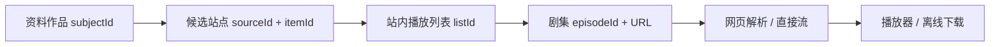
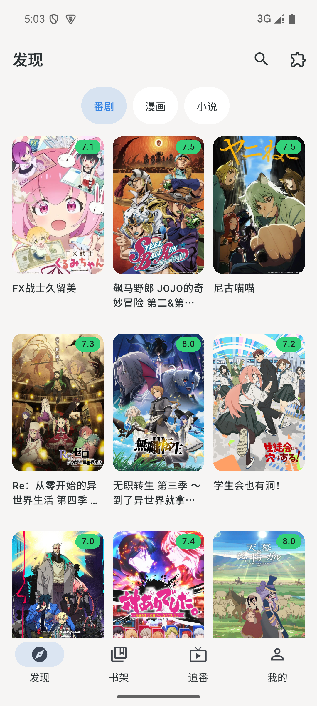
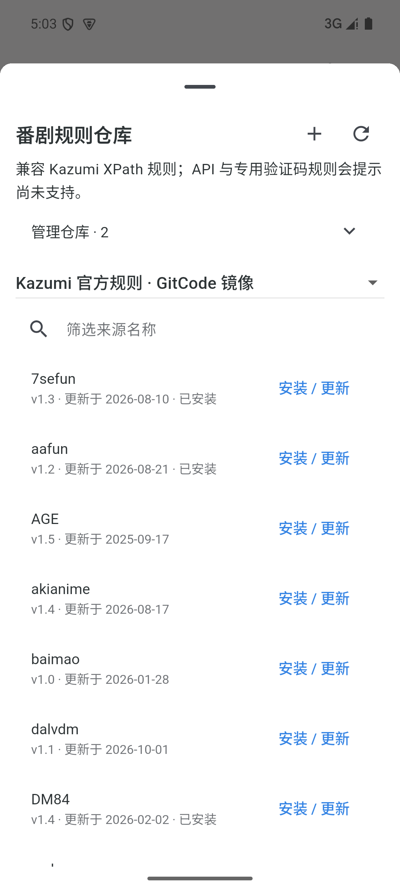
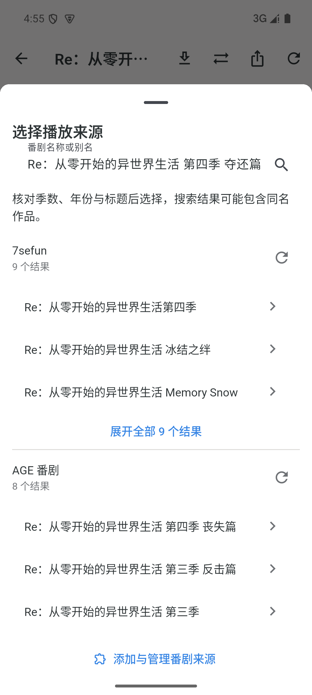
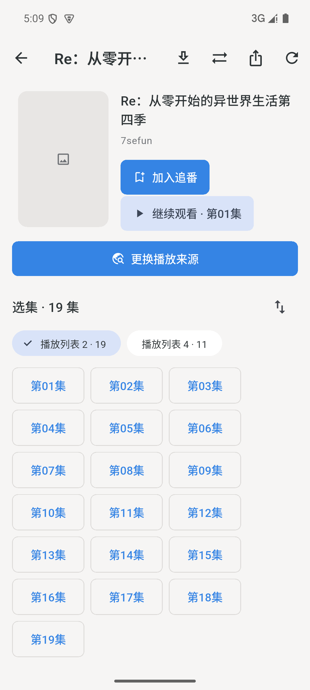
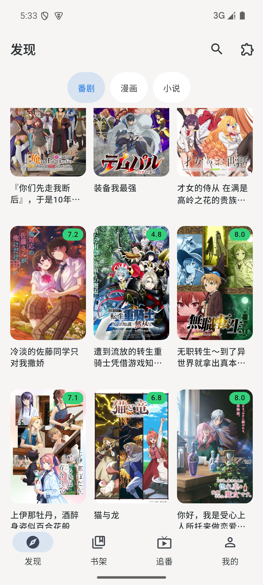
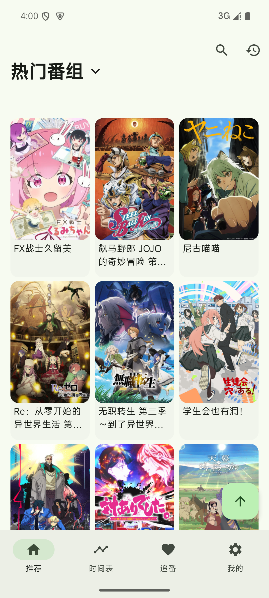
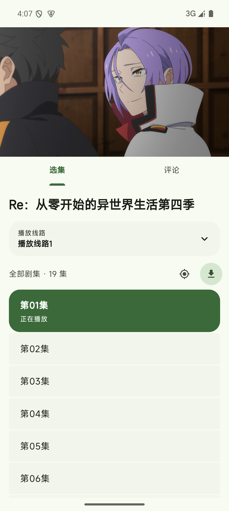
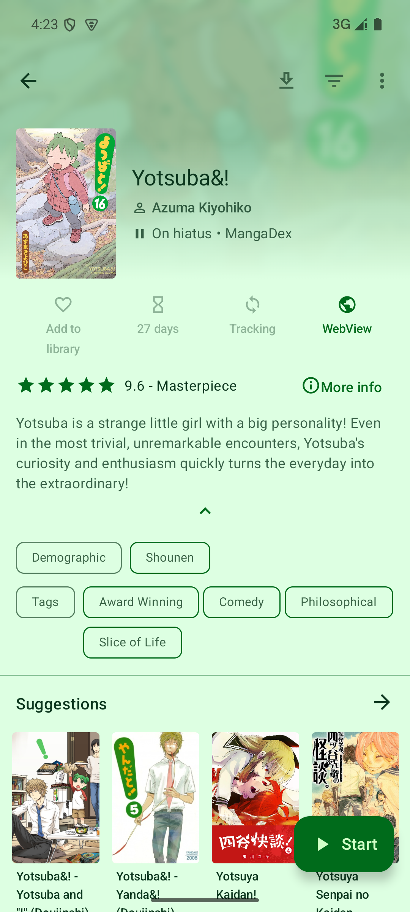
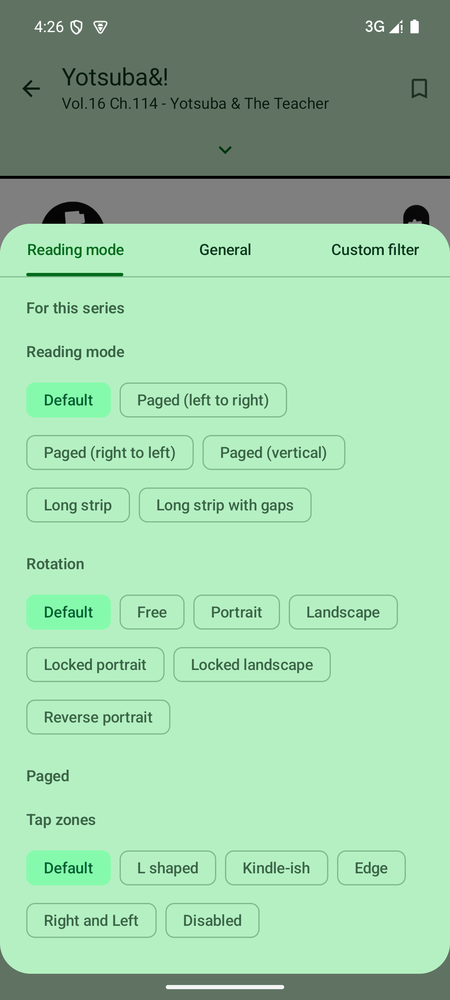

# C124 Kazumi / Komikku 源码、App 与 Triomi 整合研究

日期：2026-10-10。当前待办仍以 [ROADMAP](../ROADMAP.md) 为准；本文保存研究依据和差距，不另建并行实施计划。

## 1. 结论与调查范围

用户指出的问题成立：原番剧发现把单站榜单放在首页，资料源和播放源的关系不清晰，分集标题中的“线路一”不能代表多个网站。已有播放闭环不等于完成 Kazumi 的日常体验。漫画能执行首批 Mihon APK，也不等于对齐 Komikku 的 Feed、合并、高级阅读器和同步。

本次按完整产品模块梳理功能，并深读影响整合的数据结构与调用链；实际操作参考 App 的推荐、跨源搜索、播放、扩展管理、漫画详情和阅读设置。未逐行阅读全部源码，未实机验证全部开关、云同步、所有站点或所有平台。下面的“源码确认”与“App 操作”分别记录。

| 对象 | 本地源码版本 | 实际安装的参考 App |
|---|---|---|
| Kazumi | `02afdabf72af7eee04a7403786ee60236701086c`，源码 pubspec 2.3.7+20307 | 官方 Android 2.3.8，versionCode 203082 |
| Komikku | `64aeb48f31a211e734dafe6c838ae2c712ae69e2` | 官方 x86_64 v1.14.1，versionCode 81 |
| KazumiRules | `fce5e15a2e6b57500912d41b3f1c65bb3eb7d392` | JSON 规则索引，协议 api 1–8 |

这里的 Komikku 是 `komikku-app/komikku` Android Mihon/TachiyomiSY 分支，不是同名 GNOME 阅读器。源码与发布 APK 版本存在差异；不把源码新功能自动算作已安装版本的实测。

来源：[Kazumi](https://github.com/Predidit/Kazumi)、[KazumiRules](https://github.com/Predidit/KazumiRules)、[Komikku](https://github.com/komikku-app/komikku)。Kazumi App 源码 GPL-3.0；规则仓库 MIT，随包原规则保留 MIT LICENSE。Komikku 项目标明 Apache-2.0，具体依赖另有许可证。本轮按公开协议和行为独立接入，不直接复制上游 App 的大段实现或签名凭据。

规则快照实际统计：86个规则文件，70个标记deprecated，16个活跃规则且index也只有16项；活跃规则中2个使用API模式、4个启用专用验证码（分类可重叠）。因此“仓库里有86个文件”不能作为86个可用来源，更不能把本轮XPath支持称为整个仓库兼容。

## 2. App 操作记录与界面审计

全部在 API 35 模拟器操作，参考 App 安装后保留数据，未使用参考 App 的付费账号。

| 步骤 | 实际操作 / 截图 | 观察与边界 |
|---|---|---|
| K1 | Kazumi 推荐首页，`C124-kazumi-01-home.png` | 推荐封面网格是主内容；站点不占首页的两排常驻选择空间。 |
| K2 | 推荐→详情→来源选择，`C124-kazumi-02-sources.png` | 7sefun 有 9 个候选，DM84 单站失败；其他结果仍可选。必须保留季数和同名歧义。 |
| K3 | 7sefun→播放→选集，`C124-kazumi-03-episodes.png` | 真实视频帧和 19 集目录可见；播放列表是站内分组，不是另一个网站。 |
| M1 | Komikku 初次启动→书架，`C124-komikku-01-library.png` | 空态、权限和 SAF 下载位置独立配置。 |
| M2 | Browse，`C124-komikku-02-browse.png` | Sources / Feed / Extensions / Migrate 分开组织，扩展与来源不是同一实体。 |
| M3 | Extension repositories，`C124-komikku-03-repositories.png` | 仓库可添加，初次没有预装仓库；信任步骤需要可见。未操作云同步。 |
| M4 | 信任真实 MangaDex 1.6 APK，搜索普通漫画 Yotsuba&!→详情，`C124-komikku-04-detail.png` | 132 章目录、封面主题、标签和 Suggestions 可见；未宣称建议项全部网络加载成功。 |
| M5 | 打开 Ch.114→阅读，`C124-komikku-05-reader.png` | 真实漫画页，1/47；截图含首次 tap-zone 教学覆盖层。 |
| M6 | 阅读设置，`C124-komikku-06-reader-settings.png` | 单作品阅读模式、旋转和触摸区域设置可见；未遍历全部模式与无障碍服务。 |
| T0 | Triomi 修改前，`C124-before-discover-api35.png` | AGE 单站、“来源/最新番剧”两排筛选挤压推荐；用户反馈成立。 |

截图均在 `docs/delivery/evidence/`；已打开检查的参考截图才能支持上表。本轮使用 Product Design audit 工作流核对真实画面。后续 Triomi 最终图与构建验证见 `C124-final-release.json`。

界面修复方向：推荐页只保留番剧/漫画/小说入口和推荐网格；来源选择放在作品详情和播放器选集；单站候选默认前三条，允许展开；各站独立失败/重试；站内播放列表明确显示集数，50 集分段选择。按钮最低 48dp，但截图不能证明 TalkBack、超大字体、键盘焦点均通过，应继续专项验收。

## 3. Kazumi 全模块功能对照

下表路径均相对 `D:/noval_and_manga/_refs/kazumi/`；括号为已核对符号或行号，可在固定 commit 定位。Triomi“部分”意味着不能宣称完整对标。

| 模块 / 上游功能 | 源码依据 | App 证据 | Triomi 状态与后续 |
|---|---|---|---|
| 推荐、热门触底分页、去重、回顶、标签推荐 | `lib/pages/popular/popular_controller.dart:49` `queryBangumiByTrend`；`queryBangumiByTag`；`popular_page.dart` | K1 | C124 推荐分页/下拉刷新/去重接线；标签、年代/类型筛选、随机推荐、回顶待补。可持续加载到数据末页，不伪造无限条目。 |
| 搜索、搜索历史、原名/中文名/别名、图片搜索 | `lib/modules/search/`；[上游 source_alias_dialog.dart](https://github.com/Predidit/Kazumi/blob/02afdabf72af7eee04a7403786ee60236701086c/lib/pages/info/source_alias_dialog.dart)；`source_sheet.dart:150` | K2 | 既有全局搜索；C124 详情跨站检索、手输别名。来源独立别名缓存、原名自动备选、图片搜索未对齐。 |
| 当季/历史季番表、星期分类 | `lib/request/apis/bangumi_api.dart:34` `getCalendar`、`getCalendarBySearch`；`getBangumiMirrorSeasonCalendar` | 源码确认 | 既有时间表及后台命中通知；历史季切换和筛选未完整对齐。 |
| 详情信息、评分、角色/声优、制作人员、关联作品、评论/剧集评论 | [上游 info_tabview.dart](https://github.com/Predidit/Kazumi/blob/02afdabf72af7eee04a7403786ee60236701086c/lib/pages/info/info_tabview.dart)、`info_comments_view.dart`、`character_page.dart`；`bangumi_api.dart:361` 及 characters/staff/comments API | K2 入口 | Triomi 基础标题/封面/简介/评分/目录；资料详情网络不稳，角色、关联、staff、评论分页未整合。 |
| 来源选择、单站重试、并行搜索、过期请求取消 | `source_sheet.dart:81`、`source_sheet_view.dart`；`lib/services/plugin/plugin_search_service.dart:24,59` | K2 | C124 并发上限 4、30 秒单站等待、过期结果丢弃、单站重试、人工选候选；没有自动同名判等。 |
| 规则仓库、添加、排序、安装、批量更新、失败恢复、导入/编辑 | [上游 plugins_controller.dart](https://github.com/Predidit/Kazumi/blob/02afdabf72af7eee04a7403786ee60236701086c/lib/plugins/plugins_controller.dart)；[上游 plugin_catalog_api.dart](https://github.com/Predidit/Kazumi/blob/02afdabf72af7eee04a7403786ee60236701086c/lib/request/apis/plugin_catalog_api.dart)；`plugin_import_parser.dart` | K2 已安装规则 | C124 多仓库增删/启停/筛选/逐项安装更新、本地规则注册。批量更新/兼容预检/仓库健康和编辑器待补。 |
| XPath/API 模式、UA/Referer/POST、旧协议标志 | `lib/plugins/plugins.dart:19,205,251`；`xpath_rule_strategy.dart`；`api_rule_strategy.dart`、`api_rule_engine.dart` | K3 XPath | C124 解析 api1–8 的 XPath 子集，子树相对 XPath、POST form、UA/Referer。API 模式和启用专用验证码配置明确拒绝；不能把 api 字段理解为 searchMode。旧特殊标志未全面适配。 |
| 验证码、站点 Cookie、浏览器交互 | `source_captcha_flow.dart`；`captcha_verification_service.dart`、`plugin_cookie_manager.dart` | 本轮未完成验证码 | Triomi 既有 Mihon 可见 WebView/Cookie 方案；Kazumi 规则的验证码状态机尚未桥接。 |
| 网页嗅探、iframe、解析池、预解析、超时/广告过滤 | [上游 webview_video_source_service.dart](https://github.com/Predidit/Kazumi/blob/02afdabf72af7eee04a7403786ee60236701086c/lib/services/video_source/webview_video_source_service.dart)、`video_source_resolver_pool.dart` | K3 | Triomi 既有原生 WebVideoResolver；C124 规则提供网页/直接流。复杂网站与外部解析未全覆盖，不能从目录成功推导视频成功。 |
| 独立播放列表、列表集数、当前集定位、长目录、下载选集 | `lib/pages/video/episode_selection_panel.dart:11,57,63` | K3 | C124 详情/播放器共用选集，列表集数/50集范围/正倒序/锁集/当前段；末集不自动跳另一列表。批量选集下载待视频下载阶段。 |
| 播放、续播、自动下一集、倍速/长按倍速、seek、手势、全屏/比例、键盘 | [上游 video_controller.dart](https://github.com/Predidit/Kazumi/blob/02afdabf72af7eee04a7403786ee60236701086c/lib/pages/video/video_controller.dart)、`video_page.dart`；`lib/pages/settings/player_settings.dart:31` | K3 部分 | 基础播放/续播/倍速/全屏已有；本轮补同列表上一/下一集与播放器更换站点入口。长按倍速、亮度音量手势、比例/快捷键完整配置及自动连播回归待补。 |
| 硬解、渲染器、OpenSLES、PiP、后台音频、无痕、诊断 | `player_settings.dart:31` 与 `video_fullscreen_controller.dart` | 源码确认 | Triomi 原生 Media3 与桌面 media_kit 并非原样同核；PiP/后台音频/硬解诊断/无痕需分别落地，不能仅移植开关。 |
| 弹幕匹配/发送、顶底滚动、字号/速度/透明/描边/区域、去重/屏蔽词/Bili/Gamer | [上游 danmaku_settings.dart](https://github.com/Predidit/Kazumi/blob/02afdabf72af7eee04a7403786ee60236701086c/lib/pages/settings/danmaku/danmaku_settings.dart)；`lib/modules/danmaku/` | K3 入口 | Triomi 既有弹弹play API与显示/设置/屏蔽词；真实调用需用户自己的凭据。Bili/Gamer聚合、上游全参数/自动匹配未对齐。 |
| 追番5状态、评分、分组/筛选、历史续播、收藏网格 | [上游 collect_type.dart](https://github.com/Predidit/Kazumi/blob/02afdabf72af7eee04a7403786ee60236701086c/lib/modules/collect/collect_type.dart)；`collect_library_query.dart`；[上游 history_list_query.dart](https://github.com/Predidit/Kazumi/blob/02afdabf72af7eee04a7403786ee60236701086c/lib/pages/history/history_list_query.dart) | 源码确认 | 本地追番/评分/历史已有；同一资料ID挂多播放站点、最后来源/列表持久化和高级筛选待做。当前换站为另一站点条目。 |
| HLS master/nested、分片并发、暂停恢复/重试、磁盘空间、离线playlist、弹幕下载 | `lib/services/download/download_manager.dart:94,135,333,343,407`；`download_settings.dart` | 未下载验收 | Triomi 有通用队列、小说/漫画缓存、直接文件和明文HLS逐段合并/至多两跳master解析；网页番剧解析下载、分片保留恢复/并发/离线playlist尚未达到 Kazumi。 |
| Bangumi 双向收藏/进度冲突计划、WebDAV 收藏/历史/屏蔽词 | `lib/pages/settings/sync/sync_settings_page.dart:25`；[上游 collect_sync_merger.dart](https://github.com/Predidit/Kazumi/blob/02afdabf72af7eee04a7403786ee60236701086c/lib/modules/collect/collect_sync_merger.dart) | 未登录/同步操作 | Triomi 有追踪接口和备份基础；不宣称已有上游完整双向合并策略。需独立可审查冲突计划。 |
| 主题/布局、字体、语言、代理、镜像/ECH、缓存/存储恢复 | `lib/pages/settings/`；`lib/services/network/`；[上游 storage_error_page.dart](https://github.com/Predidit/Kazumi/blob/02afdabf72af7eee04a7403786ee60236701086c/lib/pages/error/storage_error_page.dart) | K1 | Triomi 主题和统一布局已有；C124 公开推荐镜像及 Bangumi 封面超时镜像。ECH/系统代理完整链、缓存治理待补；TLS校验保持开启。 |
| App 更新、各平台适配、DLNA/一起看/Anime4K | `lib/services/update/`；`lib/pages/video/` 相关组件 | 未执行 | App正式更新链/桌面发布待做；DLNA、一起看、Anime4K、MyAnimeList继续按原要求暂缓。 |

## 4. Komikku 全模块功能对照

路径相对 `D:/noval_and_manga/_refs/komikku/`。Kotlin应用不能直接整体嵌进Flutter页面；保留 source-api ABI 的 Android 宿主、把稳定协议与业务行为迁入统一模型。

| 模块 / 上游功能 | 源码依据 | App 证据 | Triomi 状态与后续 |
|---|---|---|---|
| Sources/Extensions/Migrate、语言/名称/NSFW筛选、来源分类/固定 | `README.md:53`；`app/src/main/java/eu/kanade/tachiyomi/ui/browse/` | M2 | 来源管理、中文筛选和APK启停已有；语言/NSFW/source类别/批量启停和按最近使用组织部分缺失。 |
| 多仓库添加/移除/启停/图标/刷新、仓库元数据/发布者信任 | `data/src/main/java/mihon/data/extension/repository/ExtensionStoreRepositoryImpl.kt:19,38,78`；`app/.../settings/screen/browse/ExtensionStoresScreenModel.kt:22` | M3 | Triomi 已有Mihon仓库添加和实际签名pin，不是只有APK目录；Komikku等价repo启停/图标/统一失败隔离需继续对齐。 |
| source-api运行、HttpSource/SourceFactory、Cookie、UA、网页登录、来源设置/图片处理 | `app/src/main/java/eu/kanade/tachiyomi/source/`、`extension/` | M4/M5 | Triomi已有真实Android宿主，MangaDex/拷贝/Jinman首批闭环；全仓库ABI覆盖/登录挑战未全完成，Windows不执行APK。 |
| 单源popular/latest/filter、跨源全局搜索、保存搜索chips | `app/.../ui/browse/source/browse/`；`ui/browse/source/feed/SourceFeedScreenModel.kt:278,310` | M4 搜索 | 单源发现和搜索已有；原始FilterList全面桥接、saved search chips及过滤持久化未对齐。 |
| 全源Feed、saved search feed、排序/备份/同步、最多20条项 | `app/.../ui/browse/source/feed/SourceFeedScreenModel.kt:71,158,179,211`；`presentation/browse/FeedScreen.kt` | M2入口 | 聚合Feed未实现，不把现有按源榜单称Feed；需要来源隔离、失败重试与稳定游标。 |
| 网站Suggestions、MAL/AniList/Neko推荐、无源元数据SmartSearch | `app/src/main/java/exh/recs/RecommendsScreenModel.kt`、`BrowseRecommendsScreenModel.kt`；README | M4建议区域 | 通用网页建议与漫画推荐未整合；站点相关作品与追踪推荐来源应区分。MyAnimeList仍暂缓。 |
| 详情/标签局部与全局搜索、自定义信息/封面、宽封面分享/保存 | `app/.../ui/manga/`；README SY列表 | M4 | Triomi基础详情/标签已有；标签双操作、编辑信息/封面、全景封面待补。 |
| 分类/隐藏分类、动态分类、批量收藏/merge、拖排、封面主题、来源语言标志 | `app/.../ui/library/LibraryScreenModel.kt`；README | M1 空书架 | Triomi本地分类/排序/评分/置顶/网格及来源语言APK标签已有；隐藏/动态分类、批量收藏、拖排、封面配色未完整对齐。 |
| 复杂书架搜索（排除/引号/追踪状态）、过滤已读/未读/下载 | `LibraryScreenModel.kt` 及library查询模型；README | 未大书架验收 | Triomi基础搜索与过滤已有；上游完整表达式和追踪状态过滤未对齐。 |
| 多阅读模式LTR/RTL/vertical/webtoon/continuous、旋转、tap zones、音量键、缩放 | `app/.../ui/reader/setting/ReaderPreferences.kt:13`；`presentation/more/settings/screen/SettingsReaderScreen.kt` | M5/M6 | Triomi分页/长条、方向、缩放、点击翻页、音量键等基础已有；全部viewer与每作品覆盖配置需对齐。 |
| 自动webtoon、智能背景/边距、裁边、双页切割/旋转、滤镜/灰度/反色、亮度 | `ReaderPreferences.kt:90,114,137` | M6 入口 | 未完整实现；不能把全局主题等同像素滤镜/裁边。先落地每作品设置再增加图像处理。 |
| 自动滚动、跳已读/过滤/重复章、预载线程/缓存大小、章节过渡 | `ReaderPreferences.kt:102,176`；reader viewer/loader | M5 部分 | Triomi相邻预载、错误重试/长目录和续页已有；自动滚动/重复检测/缓存预算配置待补。 |
| 历史、继续阅读、续读按钮位置、阅读时长/统计 | `app/.../ui/history/`；README；reader进度模型 | M5 | Triomi历史/持久页码/续读已有；续读按钮停靠、统计和完整历史管理需补验。 |
| 下载并发/队列/暂停/重试、章节筛选、仅Wi-Fi、自动下载/删已读、目录扫描 | `app/.../data/download/DownloadManager.kt`；`SettingsDownloadScreen.kt` | 未实际下载 | Triomi通用队列和本地漫画图已有；中断文件恢复/扫描既有目录/智能清理/自动策略未对齐。 |
| 智能书架更新、限制/分类/源并发、分组更新、封面通知、待更新/错误页 | `app/.../data/library/LibraryUpdateJob.kt:141,224,306,665`；`ui/libraryUpdateError/LibraryUpdateErrorScreenModel.kt` | 未触发后台 | Triomi已有番剧后台Job/通知及书架刷新；漫画智能调度、队列预览与失败条目页面未达到上游。 |
| 迁移范围、章节/分类/追踪/历史/下载可选、章号映射、目标来源搜索 | `app/src/main/java/mihon/domain/migration/usecases/MigrateMangaUseCase.kt`；`ui/browse/migration/` | M2入口 | C122是保留原条目的本地复制，非完整迁移；范围选择、下载重绑、逐章历史/追踪迁移待实现。 |
| 多来源合并、独立引用、原源章节归属/优先级/更新/下载 | `app/.../source/online/all/MergedSource.kt:34,102`；domain `MergedMangaReference` | 未实际merge | 未实现。必须建立合并引用与原始章节ID，不能把两个同名收藏或本地复制叫merge。 |
| 多tracker绑定/状态、自动双向进度、增强追踪与冲突处理 | `app/.../data/track/`；`SettingsTrackingScreen.kt`；README | 未账号同步 | Triomi追踪绑定/基础进度已有；双向冲突与批量同步/不同tracker字段映射未对齐。 |
| 备份/恢复、定时备份、Feed保存、SyncYomi/GoogleDrive/WebDAV | `SettingsDataScreen.kt`；`app/.../data/sync/SyncManager.kt:41,75,262,290` | 未云操作 | Triomi备份恢复补偿/本地及SAF导出已有；Feed实体、远端冲突/自动增量与多后端同步待做。 |
| 本地文件/下载内容、CBZ等容器与目录元数据 | `app/.../source/local/`；download cache | 未导入 | 已下载本地图阅读可用；通用本地漫画库/压缩包/ComicInfo扫描未完整实现。 |
| 隐私锁/无痕/隐藏分类/敏感筛选、安全截图 | `SettingsSecurityScreen.kt`；source incognito；README | 未安全设置操作 | 凭据安全存储已有；产品级锁、无痕历史策略和分类隐藏待实现。 |
| 主题/调色板/动态色/封面主题、进度banner、App自动更新/翻译 | `SettingsAppearanceScreen.kt`；README | M4封面配色 | Triomi浅深色与统一主题已有；封面配色、操作进度banner和正式签名更新尚待。特殊站点功能按实际需求逐项兼容，不默认承诺全部。 |

## 5. 本轮具体实现与边界

1. 番剧发现：真实 Bangumi trending 24 条分页；直连失败切 Kazumi 公开推荐镜像；一次排行榜的追加固定同一后端。按原始行推进offset，再过滤和去重，避免页码卡死。刷新保留旧内容直到新请求成功；追加失败提供重试。没有伪造推荐或播放地址。
2. 多站规则：随包 7sefun v1.3、MXdm v2.4、DM84 v1.4，保留 AGE；新增来源只补种一次，不覆盖旧来源状态、不复活用户已删除规则。
3. 来源选择：作品详情和播放器选集可跨所有已启用且支持播放的番剧站点搜索；单站失败不阻断其他站；旧请求晚到不覆盖新查询；每源默认三条并可展开。季数/年份由用户核对，不自动把第二季匹配成第一季。
4. 仓库：官方和GitCode镜像预设、自定义HTTPS索引、增删/启停、筛选、逐项安装更新。2 MiB文件限制/安全重定向、索引与规则一致性、降级/同版本变更拒绝、事务替换和失败保留旧规则。仓库JSON无发布者数字签名，HTTPS及本地pin不等于APK签名或恶意代码沙箱。
5. 选集：每个站内列表保留独立目录和集数；正倒序、50集分段、当前集高亮/段定位、锁集不可选、同列表上一/下一集。XPath容器没有名称时用“播放列表 N”，不编造站点/清晰度名称。原容器可有空组，所以编号不一定连续。
6. 图片与详情：首帧未加载显示占位；仅 `lain.bgm.tv` 的HTTPS封面支持超时公开图片镜像；其余来源不改写。详情补全等待时可直接选择播放来源，不被资料网络拖住。
7. 下载边界：网页PlaySource明确失败，不请求网页保存成假MP4，不进入已下载列表；直接流与既有明文HLS下载保留。完整网页解析下载与可恢复分片列P4。
8. 播放失败恢复：设备复现解析超时后原生View已销毁，切源仍调用旧通道pause而抛MissingPluginException。原生View销毁时按viewId解绑控制器，晚到创建事件不再重新绑定已销毁页面；切源入口可在失败态继续使用。最终设备复验结果另记。PlatformException在界面仅展示可读message，保留真实错误分类。

真实桌面网络探测 `C124-kazumi-live-network.json`：推荐两页各24条；7sefun 20条/2列表、MXdm 40条/4列表、DM84 30条/3列表。三站搜索命中第二季，不能宣称与第一季自动正确匹配；取网页URL也不能代替设备视频帧。API35早期本轮包已实际播放7sefun第四季第01集，0:21/23:40视频帧可见，最终包另做复验。

公开资料镜像 `api.bgmapi.com/v0/subjects` 和 episodes 本机探测 HTTP403，未将其硬接为可靠fallback；不复制 Kazumi App 的签名凭据。资料完整性仍列后续。

## 6. 整合模型与技术决策

资料和播放职责分离。下一阶段保存“资料作品→用户确认的站点候选”关联、最后来源/列表/集以及稳定番剧收藏ID。别名只是搜索输入，不能自动证明同一作品。跨季/剧场版/合集必须人工确认；切站不直接复制时间偏移，先选择目标集。每站失败可重试，不覆盖其他站会话。

漫画合并应是 `mergedItem → [{sourceId,itemId,priority}]`，章节保留原始source/chapter归属。复制、迁移、合并为三种动作；迁移需可选范围和可恢复计划，下载文件要验证章节/页对应及hash，不能仅凭相同标题重新绑定。来源扩展继续走Android宿主，Flutter统一界面，非Android展示能力边界。

采用分段整合：复用 Triomi 数据库、Riverpod、主题、原生视频桥和现有 source-api 宿主；每段完成一个可实际操作的闭环。不要把两套App整个搬入再隐藏入口，也不要以设置开关存在代表能力可用。

## 7. 已完成与后续完整大纲入口

已完成基线：番剧Android播放/进度/追番/时间表，首批真实Mihon APK阅读/续页、Cookie/来源设置/签名更新，小说LNS登录/正文字体/离线EPUB，本地备份补偿和C122来源复制/C123来源标签。本轮C124补推荐、多播放站点、规则仓库和分组选集首轮。

后续按 ROADMAP 的 P1–P12 推进：稳定作品关联→完整规则/验证码→播放可靠性→HLS下载→资料/筛选→漫画Feed/保存搜索/建议→高级阅读器→智能更新→迁移/合并→双向追踪→备份同步→发布与S1–S9补验。每项在 ROADMAP 写用户动作、依赖和验收，不以测试项数替代完成度。

本轮回归、最终release hash、两个API设备实际结果、失败项均以 `C124-final-release.json` 为准；C123 的724项和旧APK hash只代表历史，不混作C124验收。

最终补验：API35连续上滑8次，后续推荐真实封面可见；回顶下拉刷新后加载完成。API26最终包7sefun列表4第01集显示真实视频1:57/23:40；API35列表4也实际播放，列表2的解析超时保留。API35错误后“选集→更换播放来源”实际进入多站候选，原生View解绑修复已包含最终包。

证据边界：API35播放器选集的无障碍树包含11集、两个列表与换源按钮，动作可执行，但`C124-final-api35-player-episodes.png`保存的是原生视频画面，未显示浮层，不能用它证明选集视觉布局；选集视觉证据使用下方实际详情页截图。原生视频与浮层合成/截图一致性列入P3专项核对。

## 8. 已检查的界面证据

推荐首页与规则仓库：

参考 Kazumi 的推荐及选集、Komikku 的普通漫画详情及阅读设置：

